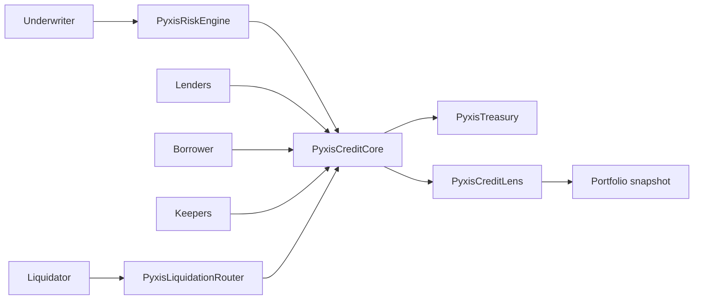

# PyxisCreditProtocol


PyxisCreditProtocol es un protocolo Vyper para originar y administrar lineas de
credito rotativas con liquidez de lenders, limites por prestatario, intereses
acumulados, pagos minimos periodicos, default operativo y liquidacion de
colateral.

El sistema modela un mercado de credito institucional donde un underwriter
aprueba limites, los prestatarios aportan colateral y los lenders financian un
pool comun de liquidez. Los keepers mantienen checkpoints de ciclo y ejecutan
liquidaciones cuando una linea incumple sus condiciones.

## Componentes

- `src/core/PyxisCreditCore.vy`: contrato desplegable principal para lineas,
  drawdowns, repayments, checkpoints, default y liquidacion.
- `src/PyxisCreditProtocol.vy`: superficie monolitica ampliada con vistas y
  administracion avanzada del protocolo.
- `src/risk/PyxisRiskEngine.vy`: perfiles de prestatario, politicas sectoriales
  y covenants.
- `src/lens/PyxisCreditLens.vy`: vistas agregadas para dashboards, lenders y
  keepers.
- `src/treasury/PyxisTreasury.vy`: buckets de reserva, recuperaciones y pagos
  operativos.
- `src/liquidation/PyxisLiquidationRouter.vy`: tickets de liquidacion y rutas de
  ejecucion.
- `src/governance/PyxisConfigurator.vy`: configuracion con cola temporal y
  guardianes.
- `src/mocks/PyxisUSD.vy`: token ERC20 usado por la suite de integracion.

## Requisitos

- Python 3.11, 3.12 o 3.13.
- Vyper 0.4.3.
- Titanoboa 0.2.8.
- pytest.

Instalacion local:

```bash
python -m venv .venv
source .venv/bin/activate
python -m pip install --upgrade pip
python -m pip install -e .
```

En Windows PowerShell:

```powershell
python -m venv .venv
.\.venv\Scripts\Activate.ps1
python -m pip install --upgrade pip
python -m pip install -e .
```

## Comandos

Compilar contratos:

```bash
python scripts/compile.py
```

Ejecutar tests:

```bash
python -m pytest -q
```

Validacion completa:

```bash
bash scripts/ci.sh
```

Comprobar tamano de `src/`:

```bash
python scripts/check_loc.py
```

## Flujos Cubiertos

La suite de Python despliega contratos Vyper reales con Titanoboa y cubre:

- deposito de liquidez por lenders;
- apertura de linea por underwriter;
- aportacion de colateral;
- drawdown de prestatario;
- acumulacion de intereses por tiempo;
- repayment con aplicacion a interes y principal;
- checkpoint de ciclo;
- default por impago;
- liquidacion parcial con seizure de colateral.

## Estructura

```text
.
├── src/
│   ├── core/
│   ├── governance/
│   ├── lens/
│   ├── liquidation/
│   ├── mocks/
│   ├── risk/
│   └── treasury/
├── tests/
├── scripts/
├── .github/
├── .vscode/
├── README.md
├── SECURITY.md
└── pyproject.toml
```

## Estado

La linea estable es `Production 1.0.0` (`v1.0.0`). `main`, `production` y el
tag anotado identifican el mismo codigo; la integridad se comprueba en CI.
El paquete se compila con Vyper 0.4.3 y sus pruebas se ejecutan sin servicios
de red ni credenciales. El repositorio no presupone un despliegue en cadena.

## Arquitectura De Credito



El contrato `Core` mantiene saldos, obligaciones y el estado de cada linea.
`RiskEngine` separa limites y covenants por perfil; `Treasury` administra
buckets de reserva; `Lens` expone vistas de lectura para integraciones. El
analizador de cartera en `src/operations/portfolio.py` consume una exportacion
JSON y no firma ni envia transacciones.

## Modelo Economico

Para una linea, la deuda observada es `principal + interes contabilizado +
interes pendiente`. El interes pendiente utiliza principal, APR en puntos
basicos y segundos transcurridos:

```text
interes = principal × APR_bps × segundos / 10_000 / 31_536_000
```

El capital prestado se reconcilia por linea y por prestatario. El colateral
queda segregado del efectivo disponible para nuevas disposiciones. Los pagos
reducen primero interes contabilizado y despues principal; las liquidaciones
limitan el colateral transferible al saldo disponible. Las formulas, unidades
y ejemplos estan en [modelo economico](docs/modelo-economico.md).

## Analisis De Cartera

```bash
python src/operations/portfolio.py examples/portfolio.json
```

La salida agrupa exposicion por sector, utilization, cobertura de colateral,
APR ponderada y una perdida de estres parametrizada en puntos basicos. Todos
los importes de entrada son enteros en unidades base del token; el analizador
no modifica contratos. Ver [integracion](docs/integracion.md) para el contrato
JSON y [operacion](docs/operacion.md) para las comprobaciones antes de publicar
una exportacion.

## Documentacion

- [Arquitectura y responsabilidades](docs/arquitectura.md)
- [Modelo economico y unidades](docs/modelo-economico.md)
- [Integracion y formato JSON](docs/integracion.md)
- [Operacion y observabilidad](docs/operacion.md)
- [Seguridad y controles](SECURITY.md)
