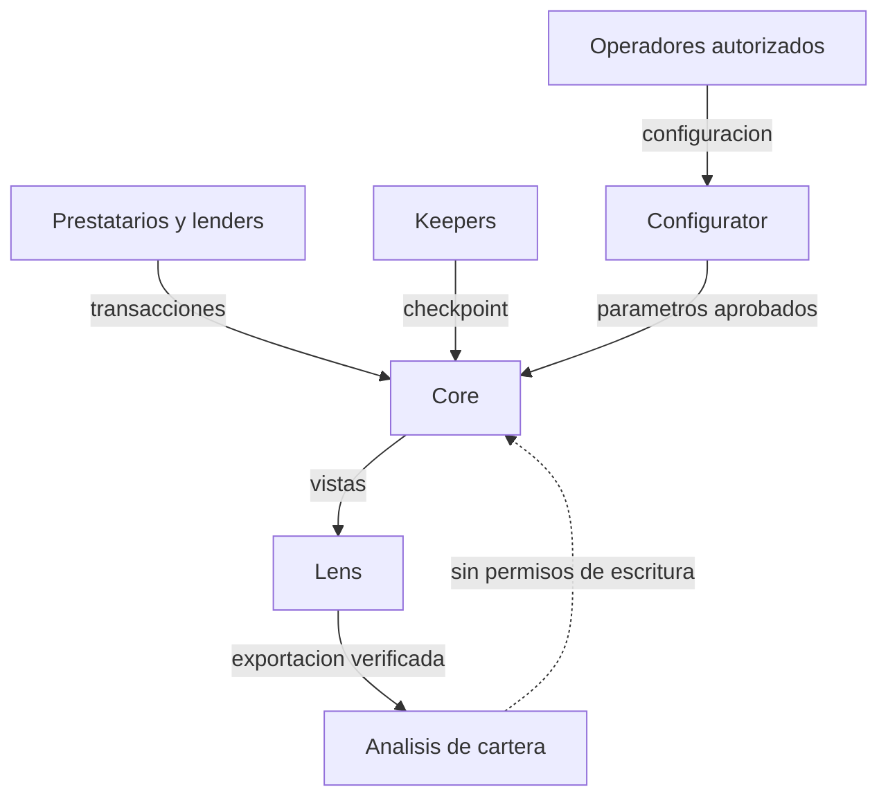

# Security Policy

## Modelo De Seguridad

PyxisCreditProtocol asume un modelo con roles diferenciados:

- `owner`: parametros globales y pausas de emergencia.
- `underwriter`: apertura de lineas y autorizacion de keepers.
- `keeper`: checkpoints operativos y mantenimiento de estados.
- `borrower`: drawdowns, colateral y repayments de su propia linea.
- `lender`: deposito de liquidez en el pool.
- `liquidator`: repayment de deuda en default a cambio de colateral.

Los contratos evitan dependencias externas fuera del ERC20 de liquidacion. La
suite de integracion usa un token mock para validar el comportamiento economico
sin servicios externos.

## Invariantes Esperadas

- Una linea no puede superar su limite aprobado.
- El pool no puede transferir liquidez reservada como colateral.
- El colateral minimo debe estar aportado antes del drawdown.
- Los intereses se acumulan proporcionalmente a principal, APR y tiempo.
- Los repayments aplican primero a interes contabilizado y despues a principal.
- Una linea impagada tras vencimiento y gracia puede pasar a default.
- La liquidacion reduce deuda y no puede incautar mas colateral del disponible.
- El total de principal agregado debe reconciliar con las lineas activas.

## Validacion Automatizada

La validacion local recomendada es:

```bash
bash scripts/ci.sh
```

Ese flujo compila todos los contratos Vyper, ejecuta la suite de pytest y valida
que `src/` se mantenga dentro del rango de lineas esperado para el paquete de
protocolo.

## Dependencias

Las dependencias Python estan definidas en `pyproject.toml`:

- `vyper==0.4.3`
- `titanoboa==0.2.8`
- `pytest`

Dependabot esta configurado para revisar dependencias de Python y GitHub
Actions semanalmente.

## Alcance De Revision

Dentro de alcance:

- contratos Vyper en `src/`;
- tests Python en `tests/`;
- scripts reproducibles en `scripts/`;
- configuracion de CI y editor.

Fuera de alcance:

- despliegues en redes publicas;
- oraculos externos no incluidos;
- integraciones off-chain de underwriting;
- frontends o dashboards no incluidos.

## Reporte Interno

Los hallazgos deben incluir:

- descripcion del comportamiento observado;
- impacto economico;
- ruta de reproduccion;
- contratos y funciones afectadas;
- cambios recomendados;
- tests que deberian fallar antes de la mitigacion y pasar despues.

## Limites De Confianza



Las vistas y el analizador externo no son fuentes de verdad para la
liquidacion. Las decisiones que cambian estado se autorizan y ejecutan en los
contratos. Antes de distribuir una exportacion, el operador debe comprobar
bloque, red, direccion del contrato, decimales y consistencia de los totales.

## Verificaciones Economicas

- `principal <= limite` para cada linea y principal agregado reconciliado.
- Liquidez disponible calculada tras separar colateral y reservas.
- APR, puntos basicos y calendario expresados con unidades explicitas.
- Cada cambio de estado deja un evento y puede reconstruirse desde un bloque.
- Las politicas de sector limitan exposicion y la configuracion requiere los
  roles previstos.

La suite de CI compila Vyper, ejecuta tests de contratos y del analizador, y
valida la identidad del tag estable frente a `main` y `production`.
