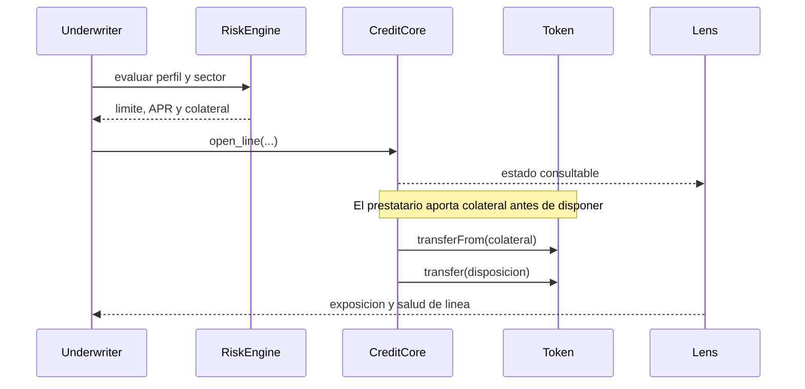
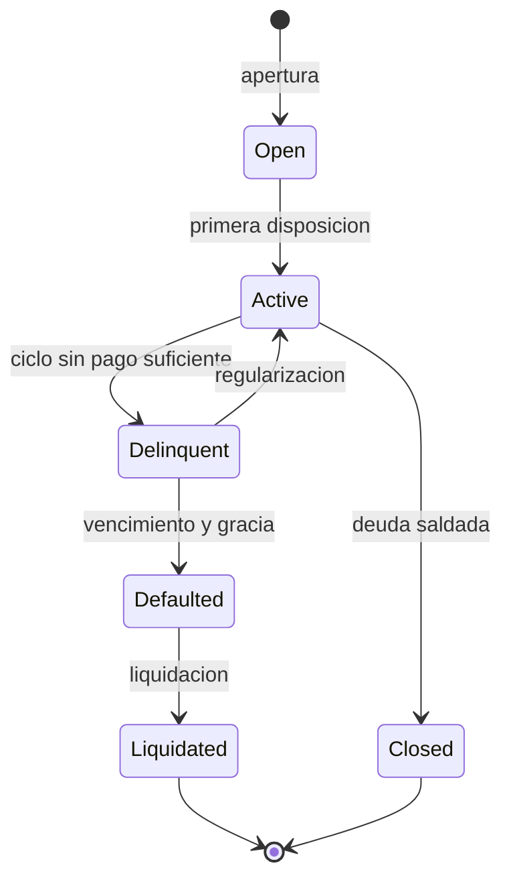

# Arquitectura de Pyxis

Pyxis separa la originacion de credito, el libro de deuda, la custodia del
activo de liquidacion y las vistas operativas. El punto de coordinacion es
`PyxisCreditCore.vy`: no delega la contabilidad de principal o intereses a un
servicio externo.

## Responsabilidades

| Componente | Estado que administra | Interfaz principal |
| --- | --- | --- |
| `CreditCore` | Lineas, deuda, saldos y vencimientos | `open_line`, `draw`, `repay`, `checkpoint`, `liquidate` |
| `RiskEngine` | Perfil, sector y covenants | evaluacion y limites |
| `Treasury` | Reserva, recuperaciones, fees y buffer | buckets y movimientos autorizados |
| `Configurator` | Cambios programados de parametros | propuesta, espera y ejecucion |
| `LiquidationRouter` | Tickets de ejecucion | preparacion y aplicacion de liquidaciones |
| `CreditLens` | Vistas agregadas | consultas sin escritura |
| `portfolio.py` | Informe sobre exportacion | calculo local determinista |

## Flujo de estado

El contrato conserva `next_due`, `minimum_due` y `paid_since_checkpoint`
como datos de ciclo. Los keepers pueden llamar `checkpoint` para materializar
el estado de una linea. La interfaz `Lens` sirve para lectura, pero las
transacciones deben consultar directamente los contratos de estado.

## Despliegue y dependencias

La construccion local compila cada archivo Vyper de `src/` con la version
fijada en `pyproject.toml`. Los tests usan un token ERC20 local y un entorno
EVM en memoria. El repositorio no incluye direcciones de red ni claves. Un
despliegue externo requiere definir activo, roles, parametros y proceso de
gobierno en el entorno correspondiente.
