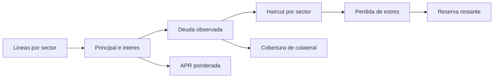

# Modelo economico y unidades

Pyxis usa enteros para todos los importes. `amount(1)` en los tests equivale
a `10^18` unidades base del token local. Los puntos basicos (`bps`) tienen
denominador `10_000`: 1.200 bps representan 12 % anual.

## Balance de una linea

```text
deuda_observada = principal + interes_contabilizado + interes_pendiente
interes_pendiente = principal * APR_bps * segundos / 10_000 / 31_536_000
capacidad_de_disposicion = min(limite - principal, liquidez_disponible)
liquidez_disponible = max(0, saldo_token_core - colateral_segregado)
```

Las operaciones de division entera truncan hacia abajo. Para conciliar una
exportacion con el contrato, use siempre las unidades base originales y
aplique el mismo orden de operaciones antes de mostrar decimales.

Ejemplo: una disposicion de `100_000` unidades, APR de 1.200 bps y 30 dias
genera aproximadamente `986,30` unidades de interes antes del truncamiento
en la unidad base. El ejemplo no incluye comisiones adicionales.

## Capital, reservas y cobertura

El analizador local calcula:

```text
utilizacion_bps = principal_total * 10_000 / capital_lenders
cobertura_bps = colateral_total * 10_000 / deuda_total
APR_ponderada_bps = suma(principal_i * APR_i) / principal_total
efectivo_libre = efectivo - colateral_segregado - reserva
```

Un valor de cobertura es un cociente contable, no un precio de realizacion.
Una liquidacion puede recuperar menos que el valor nominal del colateral; por
eso el riesgo tambien se evalua por perfil, sector y estado de vencimiento.

Con la exportacion de ejemplo, dos lineas activas suman `150_000` de
principal, `2_000` de interes y `62_000` de colateral. El capital de lenders
es `600_000`, de modo que la utilizacion es `2_500` bps. La APR ponderada es
`1_266` bps por truncamiento entero.

## Escenario sectorial

`sector_stress_bps` aplica un haircut a la deuda observada de cada sector:

```text
perdida_sector = deuda_sector * haircut_bps / 10_000
reserva_restante = max(0, reserva - suma(perdida_sector))
```

Para el ejemplo, comercio aporta `101_200` de deuda con 600 bps de estres,
y servicios `50_800` con 400 bps. Las perdidas indicativas son `6_072` y
`2_032`; total `8_104`. La reserva inicial de `20_000` deja `11_896`.
Esto es una sensibilidad determinista, no una valoracion de mercado ni un
pronostico de recuperacion.


