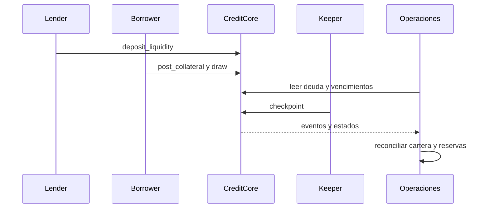

# Operacion y observabilidad

El ciclo operativo separa originacion, seguimiento, checkpoint de linea y
liquidacion. Los roles de escritura permanecen en los contratos; el informe
de cartera es una herramienta de observacion.

## Rutina por ciclo

- Comprobar saldos del activo, capital lender, colateral segregado y
  disponibilidad antes de admitir disposiciones nuevas.
- Revisar lineas proximas a `next_due`, pagos recibidos y eventos de
  checkpoint; registrar bloque y marca de tiempo.
- Comparar exposicion sectorial con las politicas vigentes en `RiskEngine`.
- Ejecutar el analizador sobre una exportacion coherente y archivar entrada,
  salida y hash. Una exportacion no sustituye el estado on-chain.
- Investigar diferencias entre contadores agregados y suma de lineas antes
  de usar el informe para decisiones operativas.

## Indicadores

| Indicador | Interpretacion | Accion inicial |
| --- | --- | --- |
| Utilizacion elevada | Poca capacidad para nuevas disposiciones | Revisar efectivo libre y compromisos |
| Cobertura reducida | Menor margen contable de colateral | Revisar valoracion y perfil |
| Reserva estresada | Sensibilidad sectorial supera buffer | Escalar a control de riesgo |
| Vencimientos pendientes | Lineas que requieren seguimiento | Reconciliar eventos de pago y checkpoint |

## Incidentes y cambios

Una pausa se opera mediante el rol autorizado de `CreditCore`. Los cambios
de parametros de riesgo o tesoreria requieren el flujo de configuracion
aplicable, revision y registro del identificador de transaccion. No se
recomienda editar archivos de exportacion para resolver discrepancias. La
respuesta inicial es conservar el bloque de origen y repetir lecturas.

## Publicacion estable

CI ejecuta compilacion Vyper, tests de contrato, tests del analizador y
comprobacion de tamano del codigo. El job de integridad verifica que `main`,
`production` y el tag anotado `v1.0.0` apuntan al mismo commit. El release
`Production 1.0.0` identifica el artefacto de codigo; no implica que se haya
ejecutado un despliegue en una red externa.
